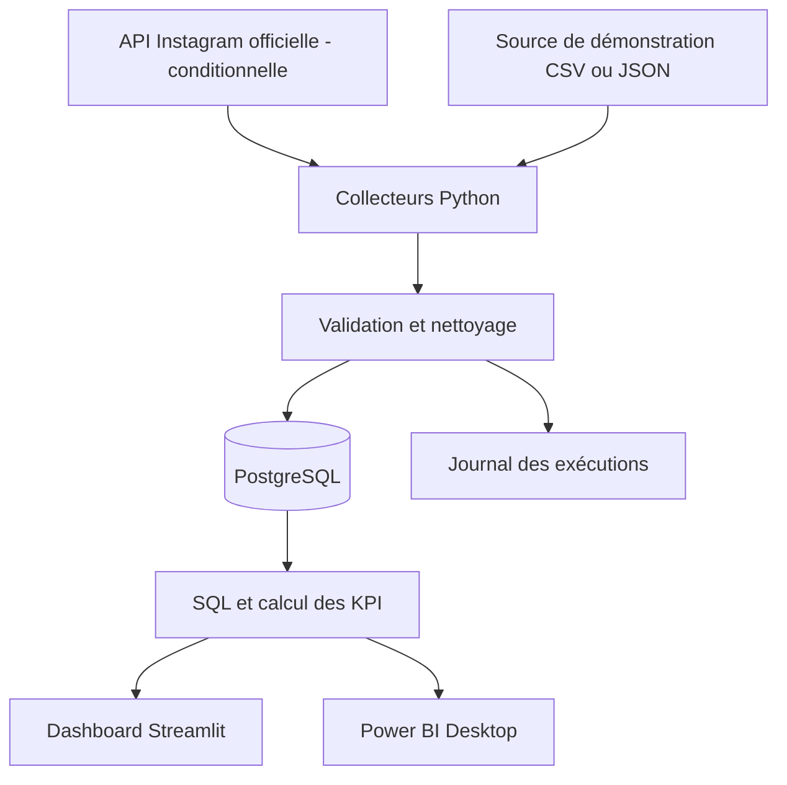

# Architecture — cible, non encore implémentée

## Principes

- **Sources interchangeables :** API réelle ou démonstration, mêmes données normalisées en sortie.
- **Historisation :** plusieurs relevés par publication pour comparer à âge égal, si les métriques sont disponibles.
- **Idempotence :** une exécution répétée ne doit pas dupliquer les observations.
- **Sécurité :** secrets dans l'environnement local / mécanisme de secrets du service d'exécution ; jamais dans Git.
- **Traçabilité :** conserver date de collecte, source, statut, erreurs, nombre de lignes.
- **V1 réaliste :** pas de FastAPI ni d'Angular exigés ; pas de cloud permanent imposé.

## Limites connues

- Les autorisations Instagram, les métriques disponibles et l'historique récupérable restent à vérifier.
- Une exécution programmée nécessite un ordinateur allumé ou un hébergement ; GitHub Actions ne peut pas atteindre une base PostgreSQL locale inaccessible.
- Power BI Desktop n'actualise pas automatiquement un tableau de bord cloud sans configuration supplémentaire.
