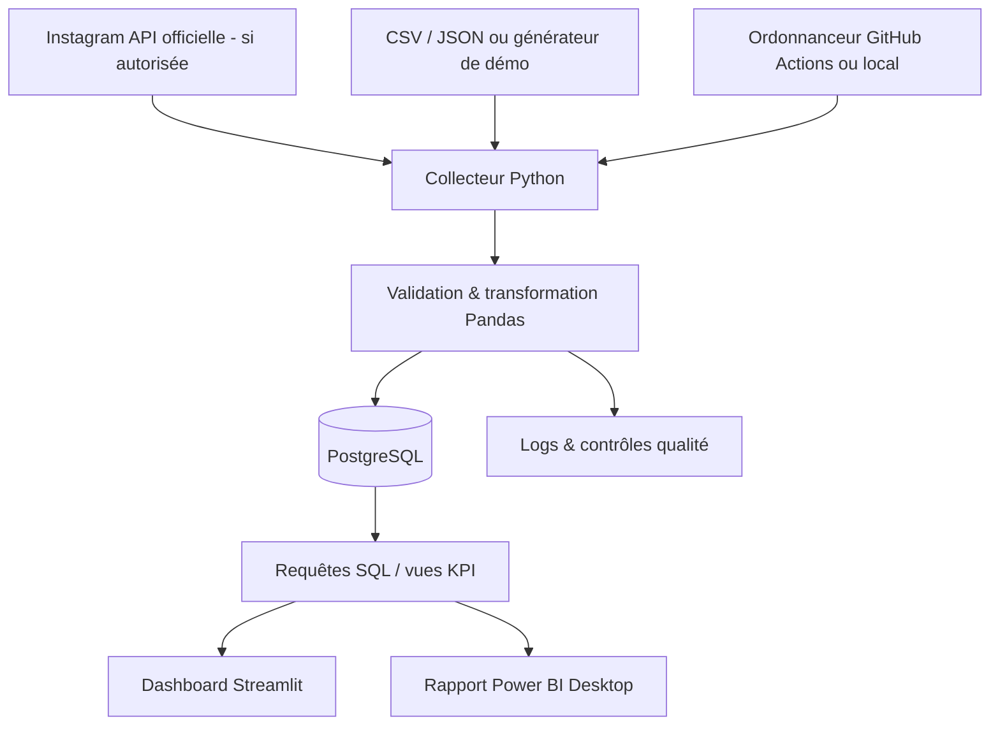

# HOKODREAM ANALYTICS
## Cahier des charges, architecture et feuille de route — Projet fil rouge Data Analyst

> **Version :** 1.0 — 21 octobre 2026  
> **Statut :** proposition de référence, à valider par une première étude de faisabilité technique  
> **Porteur :** Anis — formation Data Analyst (M2i)  
> **Finalité :** produire un projet GitHub démontrable pour rechercher un stage en Data Analysis  
> **Contexte :** HOKODREAM, activité de production vidéo et de drone FPV  
> **Confidentialité :** le code sera publiable ; les secrets et données commerciales sensibles ne le seront pas.

---

## 0. À lire avant de commencer : les engagements et les limites

Ce document **décrit précisément ce qui est prévu, ce qui est optionnel et ce qui reste à vérifier**. Il ne signifie pas que l'accès à Instagram est déjà accordé, que toutes les métriques seront disponibles ni qu'une infrastructure gratuite tournera indéfiniment sans maintenance.

### Les décisions retenues

1. **Le cœur du projet est la Data Analysis** : collecte, qualité, modélisation SQL, analyses, visualisation, conclusions métier. Le développement web est secondaire.
2. **Nous visons une automatisation quotidienne** de la collecte et des transformations **si l'API Meta autorise les accès nécessaires**. L'automatisation sera construite par étapes et testée.
3. **Une version démontrable sera possible sans Instagram**, à partir de données synthétiques clairement signalées. Ce n'est pas une substitution dissimulée aux données réelles.
4. **Aucune saisie manuelle des vues, likes, commentaires, partages et autres métriques disponibles par l'API** n'est prévue une fois l'accès validé. En revanche, une demande de devis ou une vente ne peut pas être déduite fiablement des statistiques Instagram seules.
5. **Les données clients et les jetons d'accès ne seront jamais publiés sur GitHub**.
6. **Il n'y aura pas de module de prédiction IA, d'application mobile, de publication automatique de Reels ou de CRM complet dans la V1.** Cela ferait exploser le périmètre.
7. **Un dashboard Streamlit** donnera une démonstration accessible dans un navigateur. **Un rapport Power BI Desktop** sera également produit pour valoriser le profil Data Analyst, mais sa publication et son actualisation dans le cloud seront optionnelles et soumises à des contraintes spécifiques.
8. **L'ordre de réalisation n'est pas négociable sur un point : vérifier la faisabilité de l'API très tôt.** Nous ne passerons pas un mois sur une intégration impossible à cause d'une permission manquante.

### Légende de périmètre

- **MVP** : première version complète et démontrable, avec données de démonstration, qui fonctionne même sans API Meta.
- **V1** : ajout de données réelles, collecte automatisée quand autorisée, analyse et présentation finale du portfolio.
- **V2 / option** : fonctionnalités utiles, mais non nécessaires pour postuler à un stage.
- **Conditionnel** : dépend d'un accès Meta, d'un hébergeur, d'un abonnement ou de données disponibles.

---

## 1. Résumé du projet

**HOKODREAM Analytics** est une mini-plateforme de Business Intelligence qui transforme les données d'un compte Instagram professionnel en analyses marketing interprétables.

**Question principale :** « Quels formats et contenus HOKODREAM génèrent réellement de l'attention et de l'engagement, et comment décider quoi publier ensuite ? »

**Question secondaire, seulement si nous disposons d'une source de suivi commercial fiable :** « Quels contenus ou campagnes semblent contribuer aux demandes de devis et aux projets signés ? »

Le système devra :

1. récupérer les données disponibles auprès d'Instagram par une API autorisée ;
2. archiver les observations pour créer un historique exploitable ;
3. détecter les erreurs et les données incohérentes ;
4. stocker les données dans PostgreSQL ;
5. calculer des indicateurs métier documentés ;
6. présenter les résultats dans Streamlit et Power BI ;
7. fonctionner à intervalles programmés, avec suivi des exécutions ;
8. permettre à un recruteur de lancer une démonstration avec des données fictives.

### Ce que le recruteur doit constater

- Tu sais poser une problématique métier et choisir des KPI.
- Tu sais utiliser **Python / pandas** pour un vrai flux ETL ou ELT.
- Tu sais concevoir une **base PostgreSQL** et écrire du **SQL analytique**.
- Tu sais gérer les valeurs manquantes, les doublons, les évolutions de schéma et les erreurs d'API.
- Tu sais produire un **dashboard lisible**, expliquer tes résultats et en reconnaître les limites.
- Tu sais tester, documenter et versionner du code dans **Git / GitHub**.

---

## 2. Le problème métier : questions auxquelles nous allons répondre

### Questions prioritaires — MVP / V1

- Combien de contenus ont été publiés par semaine et par mois ?
- Quelle est leur performance en vues, portée et interactions, **lorsque ces métriques sont accessibles** ?
- Quels formats (Reels, photos, carrousels) ont les meilleures performances ?
- Quelles thématiques de contenu semblent les plus efficaces : FPV cinématique, making-of, conseils, avant/après, showreel ?
- Quel pourcentage des contenus dépasse un seuil de performance défini ?
- Comment évolue le compte dans le temps ?
- Observe-t-on des différences selon le jour ou l'heure de publication ? **Ces différences seront décrites, sans affirmer qu'elles sont causales.**
- Les performances restent-elles comparables lorsqu'on observe tous les posts au même âge, par exemple à **J+7** ?

### Questions conditionnelles — extension commerciale

- Combien de demandes de devis proviennent d'un formulaire ou d'une campagne identifiée ?
- Quel est le taux de transformation de ces demandes en projets ?
- Quels contenus sont associés à des visites vers une page de contact, **uniquement si ce suivi existe réellement** ?

**Point crucial :** les vues d'un Reel ne suffisent pas à prouver qu'il a généré un client. Sans outil de suivi des prospects, cette attribution commerciale restera inconnue ; nous ne l'inventerons pas.

---

## 3. Utilisateurs cibles

| Utilisateur | Besoin | Fonction principale |
|---|---|---|
| Anis / créateur HOKODREAM | Savoir quoi produire ensuite | Dashboard de contenus et analyses |
| Responsable marketing fictif | Comparer les publications et les formats | Filtres, KPI et classement |
| Recruteur Data | Évaluer les compétences techniques et la rigueur | README, code, tests, données démo, rapport |

Le projet reste **mono-compte** en V1. La gestion de comptes multiples n'est pas prévue.

---

## 4. Périmètre fonctionnel : inclus / exclus

### MVP — indispensable

- [ ] Dépôt GitHub propre et reproductible.
- [ ] Documentation du besoin, des données et des choix techniques.
- [ ] Jeu de données de démonstration **synthétique et reproductible**, avec générateur Python.
- [ ] Ingestion depuis fichiers JSON / CSV de démo.
- [ ] Pipeline de validation, transformation et chargement.
- [ ] PostgreSQL et schéma de données relationnel.
- [ ] Requêtes SQL d'analyse métier.
- [ ] Tableau de bord Streamlit avec filtres et graphiques.
- [ ] Tests unitaires, tests d'intégration simples, contrôle de qualité.
- [ ] Exécution reproductible par commande.
- [ ] Captures d'écran, limites et conclusions dans le README.

### V1 — objectif complet du fil rouge

- [ ] Vérification puis connexion sécurisée à **l'API officielle Instagram**.
- [ ] Collecte des médias et des métriques auxquelles le compte est éligible.
- [ ] Gestion des pages de résultats, erreurs, temps d'attente et limites d'appel.
- [ ] Historique des métriques mesurées à différentes dates.
- [ ] Exécutions automatiques programmées si l'environnement le permet.
- [ ] Journal d'exécution (succès, durée, échecs, volumes).
- [ ] Analyse comparative à âge de publication égal lorsque les observations le permettent.
- [ ] Rapport **Power BI Desktop** avec des vues analytiques documentées.
- [ ] Dossier de présentation pour entretien de stage.

### V2 — uniquement après une V1 terminée

- [ ] Formulaire de contact HOKODREAM avec provenance de campagne.
- [ ] Intégration d'un CRM autorisé pour relier les leads aux campagnes.
- [ ] Notifications d'échec par e-mail ou autre canal connecté.
- [ ] Hébergement cloud permanent du pipeline / de la base.
- [ ] Publication et actualisation planifiée de Power BI Service.
- [ ] Analyses statistiques plus avancées, si le volume et la qualité des données le justifient.
- [ ] Comparaison multi-comptes, uniquement avec permissions explicites.

### Hors périmètre

- Application mobile native.
- Frontend Angular et backend FastAPI **obligatoires** (tu les connais, mais ils ne sont pas nécessaires pour prouver des compétences de Data Analyst).
- IA générative qui « prédit le succès » de chaque Reel.
- Scraping non autorisé d'Instagram.
- Achat de followers, bots d'interactions, automatisation des messages privés.
- Publication automatique de vidéos ou montage FPV.
- Gestion de facturation et comptabilité complète de HOKODREAM.
- Récupération automatique des coordonnées des prospects depuis leurs DM.

---

## 5. Faisabilité réelle de l'API Instagram — le risque n°1

> **Statut actuel : NON VALIDÉ.** Nous n'avons pas encore vérifié le type de ton compte HOKODREAM, les permissions accordées à l'application Meta, ni testé un appel donnant réellement accès à des métriques.

### Prérequis probables

1. Posséder un compte **Instagram professionnel** de type **Business ou Créateur**.
2. Créer/configurer une application dans **Meta for Developers**.
3. Choisir et configurer correctement **Instagram API with Instagram Login** ou, si nécessaire, la variante **with Facebook Login**.
4. Obtenir un jeton d'accès valide et les autorisations nécessaires aux statistiques.
5. Tester sur **ton propre compte**, dans les conditions d'accès permises par Meta.

**À ne pas confondre :** la variante *Instagram Login* ne requiert pas nécessairement de Page Facebook liée ; la variante *Facebook Login* exige généralement une Page Facebook liée à un compte Instagram professionnel. Nous privilégierons la première si les métriques voulues et les droits disponibles le permettent.

D'après la documentation Meta, les permissions à étudier pour les insights sont notamment `instagram_business_basic` et `instagram_business_manage_insights` côté Instagram Login. Les chemins, versions et métriques réellement acceptés seront validés au moyen d'une requête d'essai avant toute intégration complète.

### Premier test obligatoire : « Proof of Access »

Avant de construire un collecteur :

- [ ] Confirmer Business ou Créateur.
- [ ] Pouvoir authentifier correctement l'application.
- [ ] Obtenir l'identifiant du compte Instagram.
- [ ] Lister au moins une publication appartenant au compte.
- [ ] Lire au moins **une métrique autorisée** de cette publication.
- [ ] Documenter précisément l'API, la version et les permissions utilisées.
- [ ] Vérifier l'expiration et le renouvellement du jeton.
- [ ] Vérifier les données indisponibles / nulles et l'historique réellement accessible.

**Décision GO / NO-GO**

- **GO :** données pertinentes accessibles → développement du collecteur Meta.
- **Accès partiel :** adapter les KPI aux métriques disponibles, sans mentir sur leur disponibilité.
- **NO-GO temporaire :** continuer le projet avec le fournisseur de données `demo`/`csv`, terminer le pipeline, puis retenter l'intégration en option.

### Limitations à accepter

- Une métrique peut différer selon le type de média, le compte ou la version de l'API.
- Certaines métriques peuvent changer de nom, être supprimées, être nulles ou arriver avec retard.
- **L'historique n'est pas garanti sur toute la durée de vie du compte** ; des fenêtres temporelles s'appliquent selon le type de donnée. Collecter tôt et sauvegarder nos propres snapshots est essentiel.
- Un jeton peut expirer ou être révoqué ; une action de reconnexion peut être requise.
- Un accès destiné à ton propre compte ne garantit **pas** une autorisation de distribuer l'application à d'autres utilisateurs.
- Un compte personnel ne permet pas les mêmes accès qu'un compte professionnel.
- Il n'y a **aucune garantie** d'accès aux DM, prospects, revenus et conversions à partir des insights.

---

## 6. Sources de données et degré d'automatisation

| Source | Données espérées | Collecte | Disponibilité |
|---|---|---|---|
| Instagram — liste des médias | ID, date, type, lien, légende et métadonnées autorisées | **Automatique via API** | Conditionnelle |
| Instagram — insights par média | Vues, portée, likes, commentaires, sauvegardes, partages... **selon métrique réellement exposée** | **Automatique via API** | Conditionnelle |
| Instagram — insights du compte | Indicateurs agrégés accessibles | **Automatique via API** | Conditionnelle |
| Générateur Python de données démo | Publications, métriques simulées, profils temporels | **Automatique** | Garantie par le projet |
| Exports CSV / JSON | Données consenties ou exports compatibles | Import automatique à partir du fichier fourni | Alternative |
| Tags éditoriaux (FPV, making-of...) | Catégorisation qualitative des contenus | Règles simples + correction manuelle si nécessaire | Prévu |
| Leads / clients | Dates, sources, statuts de demandes | **Pas automatique depuis les insights** ; formulaire/CRM en V2 | Hors V1 |

**Donc :** les métriques Instagram n'auront pas à être saisies à la main si la connexion fonctionne ; en revanche, classifier une vidéo ou qualifier une vente pourra demander une action humaine. Il est préférable de l'indiquer clairement plutôt que de promettre du « 100 % automatique ».

---

## 7. Architecture fonctionnelle et technique



### Étapes d'exécution d'un pipeline

1. **Déclenchement** : commande locale ou événement programmé.
2. **Vérification des paramètres** : variables d'environnement, base joignable, source sélectionnée.
3. **Extraction** : appel API avec pagination (ou lecture du jeu de démonstration).
4. **Stockage brut maîtrisé** : sauvegarde JSON locale ou zone temporaire facultative pour audit, sans secret.
5. **Validation** : types, identifiants, dates, métriques autorisées, valeurs manquantes, doublons.
6. **Transformation** : normalisation des dates UTC, du type de média et des champs statistiques.
7. **Chargement** : insertion ou mise à jour transactionnelle en base, sans duplications.
8. **Calculs** : exécution des requêtes SQL et rafraîchissement des résultats calculés si nécessaire.
9. **Journalisation** : nombre de médias, nombre de métriques, temps d'exécution, état et erreurs.
10. **Consommation** : ouverture du dashboard et visualisation des dernières données disponibles.

**Important :** une exécution réussie du pipeline **n'entraîne pas automatiquement** l'actualisation d'un rapport publié dans Power BI Service. C'est une étape séparée à configurer, avec ses propres prérequis.

---

## 8. Technologies retenues (avec justification)

| Outil | Utilisation | Pourquoi |
|---|---|---|
| Python 3.12 ou autre version testée compatible | Pipeline et analyses | Écosystème Data mature ; compatibilité maîtrisée |
| `requests` ou `httpx` | Appels HTTPS Meta | Clients API éprouvés |
| `pandas` | Nettoyage et exploration | Compétence Data Analyst essentielle |
| PostgreSQL | Stockage et SQL | Requêtes analytiques ; pérennité |
| SQLAlchemy + `psycopg` | Connexion / persistance Python ↔ SQL | Séparation propre du code SQL et des accès |
| `pytest` | Tests unitaires / intégration | Projet fiable et montrable |
| `ruff` | Contrôles de style et de qualité | Code lisible |
| `python-dotenv` (local) | Configuration locale | Ne pas coder les secrets en dur |
| Streamlit + Plotly | Démonstration interactive | Application accessible, rapide à développer |
| Power BI Desktop | Rapport décisionnel portfolio | Valorisation de compétences BI demandées |
| GitHub Actions | Tests continus et éventuellement collecte planifiée | Automatisation démontrable |
| GitHub | Portfolio et suivi de travail | Historique, README, Issues |

**Choix assumé :** pas de Docker, FastAPI, React, Airflow, dbt ni machine learning dans le MVP. Une première version solide vaut mieux qu'un assemblage de 15 outils non maîtrisés. Docker pourrait être ajouté une fois le fonctionnement stabilisé.

---

## 9. Modèle de données — tables prévues

### `instagram_accounts`

| Colonne | Type indicatif | Rôle |
|---|---|---|
| `id` | BIGINT, PK | Identifiant interne |
| `platform_account_id` | TEXT, unique | Identifiant du compte dans l'API |
| `username` | TEXT | Nom public du compte |
| `account_type` | TEXT | Business / Creator si fourni |
| `created_at` | TIMESTAMPTZ | Création de la ligne |

### `media`

| Colonne | Type indicatif | Rôle |
|---|---|---|
| `id` | BIGINT, PK | Identifiant interne |
| `platform_media_id` | TEXT, unique | ID média Instagram |
| `account_id` | BIGINT, FK | Propriétaire du média |
| `published_at` | TIMESTAMPTZ | Date de publication |
| `media_type` | TEXT | Reel / image / carrousel... |
| `permalink` | TEXT | Lien public si disponible |
| `caption_excerpt` | TEXT, nullable | Extrait de légende ; à limiter et documenter |
| `created_at` | TIMESTAMPTZ | Date de première récupération |
| `updated_at` | TIMESTAMPTZ | Dernière mise à jour |

### `media_metric_snapshots` — table de faits principale

| Colonne | Type indicatif | Rôle |
|---|---|---|
| `id` | BIGINT, PK | Identifiant interne |
| `media_id` | BIGINT, FK | Publication concernée |
| `snapshot_date` | DATE | Date logique de la mesure (Europe/Paris, règle documentée) |
| `metric_name` | TEXT | `views`, `reach`, `likes`, etc., uniquement si collectés |
| `metric_value` | BIGINT, nullable | Valeur réelle reçue ; NULL si non disponible |
| `collected_at` | TIMESTAMPTZ | Horodatage exact de collecte |
| `source` | TEXT | `meta_api`, `demo` ou `csv` |

**Contrainte d'unicité :** `(media_id, snapshot_date, metric_name, source)` ; le pipeline doit être idempotent. Les totaux observés sont souvent des **snapshots cumulés**. On ne somme **jamais** les vues cumulées de plusieurs dates pour obtenir les vues totales d'une publication.

### `account_metric_snapshots` — si l'API le permet

`id`, `account_id`, `snapshot_date`, `metric_name`, `metric_value`, `period`, `collected_at`, `source`.

### `content_tags` et `media_tags`

- `content_tags`: `id`, `name` (FPV, backstage, conseil, showreel...).
- `media_tags`: `media_id`, `tag_id`, `assigned_by` (`rule` ou `human`).
- Une publication peut avoir plusieurs tags.

### `pipeline_runs`

`id`, `started_at`, `finished_at`, `source`, `status`, `media_seen`, `metrics_written`, `error_code`, `error_summary`.

Ne jamais enregistrer d'access token dans les logs.

### Modélisation optionnelle V2 : `leads`

Une table distincte pourra gérer `lead_id`, `created_at`, `campaign_code`, `source`, `status`. **Aucune donnée nominative n'entre dans la démo publique.** Les correspondances publication → lead devront être fondées sur un paramètre de suivi ou une information déclarée, pas supposées.

---

## 10. Dictionnaire des métriques et règles métier

| KPI | Définition retenue | Attention |
|---|---|---|
| Nombre de publications | Nombre de `platform_media_id` distincts sur une période | Attention aux publications supprimées / non disponibles |
| Vues par publication | Dernier snapshot valide `views` connu dans la période pertinente | Disponibilité variable selon média / API |
| Portée | Dernier snapshot valide `reach` | Non équivalent aux vues |
| Interactions | Likes + commentaires + sauvegardes + partages **uniquement si ces champs sont tous définis et comparables** | Sinon afficher une somme partielle explicitement nommée |
| Taux d'engagement par portée | Interactions / portée × 100 | Non calculable si portée absente ou nulle |
| Performance à J+7 | Observation connue la plus proche de 7 jours après publication, selon tolérance documentée | Ne pas assimiler J+2 à J+7 |
| Variation entre deux mesures | Valeur la plus récente − valeur précédente | Le sens de cette variation dépend de la métrique |
| Médiane des vues | Médiane des publications comparables | Souvent plus robuste que la moyenne face aux Reels viraux |
| Part des formats | Publications d'un format / nombre total de publications × 100 | Une proportion de contenus, pas une part d'audience |

### Règles analytiques essentielles

- **Ne pas diviser par zéro** : les taux non calculables deviennent `NULL` / `N/A`.
- **Ne pas transformer les valeurs absentes en zéro** sans justification : « pas disponible » n'est pas « aucune interaction ».
- **Comparer des contenus au même âge** dès que des snapshots suffisants existent (J+7, éventuellement J+30).
- Séparer au maximum **Reels, photos et carrousels**, car leurs métriques et comportements peuvent différer.
- Afficher **l'effectif `n`** à côté des comparaisons et avertir si trop faible.
- Les résultats décrivent des **corrélations et des observations**, pas un effet causal démontré.
- Toute recommandation marketing devra préciser la période observée, les métriques et la taille de l'échantillon.

### Exemple de conclusion acceptable

> « Sur 18 Reels observés à J+7, les vidéos de making-of affichent une médiane de vues supérieure aux showreels. La différence est descriptive et ne prouve pas que la catégorie cause cette performance. »

### Exemple de conclusion interdite sans source CRM fiable

> « Ce Reel a généré 3 clients », alors qu'on possède seulement ses vues et ses likes.

---

## 11. Dashboard Streamlit — pages prévues

### Page A — Vue d'ensemble

- Filtres : période, format, tag éditorial, source de données.
- KPI : publications, portée, vues, interactions, croissance observable.
- Courbe de performance dans le temps.
- Date de dernière collecte réussie et badge clair `DÉMO` ou `RÉEL`.
- Avertissements sur données manquantes et faible nombre de publications.

### Page B — Performance des contenus

- Tableau des publications avec liens vers Instagram si autorisés.
- Classement par KPI choisi et filtre sur l'âge de la publication.
- Distribution des performances, moyenne **et** médiane.
- Comparaison des Reels, images, carrousels et catégories éditoriales.
- Analyse des jours / heures avec avertissement sur les biais.

### Page C — Qualité et fraîcheur des données

- Date de dernière synchronisation.
- Nombre de publications trouvées et de métriques collectées.
- Valeurs absentes, publications ignorées et échecs de collecte.
- Historique des derniers pipelines.
- Explication de l'origine des données.

### Page D — Synthèse métier

- 3 à 5 observations factuelles, avec chiffres et période.
- Suggestions de tests éditoriaux, non promesses de résultats.
- Prochaines actions recommandées pour HOKODREAM.

### Ergonomie prévue

- Design sobre et lisible, adapté au portfolio.
- Un dashboard utilisable sur desktop sans dépendre de fonctionnalités payantes.
- Pas de données personnelles ou financières réelles exposées publiquement.
- Données synthétiques publiques par défaut ; accès aux données réelles réservé selon configuration.

---

## 12. Rapport Power BI — rôle exact

**Livrable prévu en V1 :** un fichier Power BI Desktop `.pbix` local, des captures et une documentation des transformations / mesures. Il complétera Streamlit, il ne le remplacera pas.

**Rapport ciblé :**

1. Résumé exécutif des performances.
2. Évolution temporelle et saisonnalité descriptive.
3. Analyse des formats / catégories de contenu.
4. Classement des publications et comparaisons à J+7.
5. Analyse de la qualité des données.

**Ce qui sera automatique :** la base de données et ses vues SQL peuvent être actualisées par le pipeline.

**Ce qui n'est PAS automatiquement garanti :** le rafraîchissement d'un rapport Power BI publié en ligne. Selon l'endroit où réside PostgreSQL, la publication dans le service peut nécessiter un compte/licence approprié, des droits de partage, une passerelle de données si la source est locale et la disponibilité d'une machine allumée. Ce point reste **optionnel**.

**Décision :** on construit **d'abord Streamlit** pour la démonstration, puis **Power BI Desktop** pour la compétence BI.

---

## 13. Automatisation et exploitation

### Fréquence cible

Une collecte **une fois par jour**, à une heure définie, constitue un bon point de départ. L'exécution doit aussi être possible à la demande : `python -m src.pipeline.main` (commande finale ajustable au code réel).

### Où le pipeline pourra tourner

| Scénario | Fonctionnement | Coût / contrainte |
|---|---|---|
| **Local d'abord** | Ordonnanceur de tâches Windows | Gratuit, mais le PC et PostgreSQL doivent être démarrés |
| **GitHub Actions** | Job programmé + tests automatiques | Dépend des quotas GitHub ; secrets à gérer ; base joignable depuis le runner |
| **Serveur / cloud** | Planificateur + base hébergée | Potentiellement payant ; maintenance, sécurité et sauvegardes |

**Important :** un runner GitHub hébergé ne peut pas accéder directement à une base PostgreSQL sur ton PC simplement parce qu'elle fonctionne en local. Il faudrait exposer une connexion sécurisée ou utiliser un service hébergé ; ce n'est **pas** prévu dans le MVP.

Github Actions permet des déclenchements planifiés ; leur exécution peut être retardée ou ignorée et ils peuvent être désactivés après une longue inactivité du dépôt public. Le workflow doit donc être **relançable**, non dépendant d'une exécution à la seconde près et capable de récupérer un retard dans les limites de l'API.

### Résilience attendue

- Timeout réseau explicite.
- Relance limitée sur erreurs temporaires, avec attente progressive (backoff).
- Pas de relance infinie sur authentification refusée.
- Gestion de la pagination et des limites d'appel.
- Insertion **idempotente** : deux exécutions identiques n'engendrent pas de doublons.
- En cas de coupure, pas de données partiellement enregistrées de façon incohérente.
- Logs compréhensibles et codes de sortie exploitables.
- Expiration de token : erreur visible et consigne de reconnexion, pas d'accès permanent garanti.
- Ajout d'un indicateur de **fraîcheur** dans le dashboard.

---

## 14. Sécurité, vie privée et règles d'utilisation

- Aucun mot de passe, token, clé API ou URL de base avec identifiants dans le code source.
- `.env` non versionné ; seul `.env.example` avec des valeurs factices va sur GitHub.
- Si GitHub Actions est activé : utiliser les **GitHub Actions Secrets** avec permissions minimales.
- Ne pas écrire les jetons dans les logs, traces d'erreur ou captures.
- Ne pas publier de DM, adresses e-mail, numéros de téléphone ou devis réels.
- N'utiliser que les données dont tu disposes légitimement ; respecter les règles Meta et les obligations de protection des données.
- Si le site/formulaire collecte des prospects en V2 : information des personnes, finalités, durée de conservation, contrôle d'accès et traitement conforme au RGPD à prévoir avant production.
- Le dépôt GitHub public ne contiendra que des **données synthétiques ou des données explicitement autorisées à être publiées**.
- L'accès au dashboard de données réelles sera limité ou ses sorties anonymisées.

---

## 15. Gestion des coûts — pas d'achat caché

| Poste | Objectif | Réserve importante |
|---|---|---|
| VS Code, Python, pandas, pytest | 0 € | Logiciels gratuits |
| PostgreSQL local | 0 € | Machine à faire tourner |
| GitHub public | 0 € possible | Actions soumis à quotas / politiques |
| Streamlit local | 0 € | Nécessite un PC pour lancer l'app |
| Streamlit Community Cloud | Offre gratuite possible | Limitations, mise en veille / confidentialité / ressources à vérifier |
| Meta Developers / API | Pas de budget présumé pour un prototype personnel | Accès et permissions non garantis ; vérifier conditions actualisées |
| Power BI Desktop | Utilisable gratuitement pour l'auteur | Partage, publication et rafraîchissement cloud peuvent impliquer des licences |
| Base hébergée, serveur, domaine, alertes | **Non requis** pour le MVP | Coût éventuel et devis avant toute décision |

**Budget de démarrage : viser 0 € de coût additionnel.** Cela ne signifie pas promettre qu'une solution hébergée 24h/24 sera gratuite.

---

## 16. Arborescence GitHub cible

```text
hokodream-analytics/
├── README.md
├── LICENSE
├── .gitignore
├── .env.example
├── pyproject.toml
├── requirements.txt                 # si retenu pour installation simple
├── docs/
│   ├── cahier_des_charges.md
│   ├── architecture.md
│   ├── data_dictionary.md
│   ├── kpi_definitions.md
│   ├── decisions.md
│   └── screenshots/
├── data/
│   ├── demo/                        # données synthétiques seulement
│   └── README.md
├── sql/
│   ├── schema.sql
│   ├── analytics_queries.sql
│   └── views.sql
├── src/
│   ├── config.py
│   ├── collectors/
│   │   ├── base.py
│   │   ├── instagram.py
│   │   └── demo.py
│   ├── transformations/
│   │   ├── clean.py
│   │   └── validate.py
│   ├── storage/
│   │   └── repository.py
│   ├── analytics/
│   │   └── kpis.py
│   └── pipeline/
│       └── main.py
├── dashboard/
│   └── app.py
├── powerbi/
│   └── README.md                    # .pbix à ajouter quand prêt
├── scripts/
│   ├── generate_demo_data.py
│   └── init_db.py
├── tests/
│   ├── test_clean.py
│   ├── test_kpis.py
│   ├── test_pipeline.py
│   └── test_instagram_mock.py
└── .github/
    └── workflows/
        ├── ci.yml
        └── scheduled_sync.yml        # V1, lorsque possible
```

**Note :** cette structure est la cible, pas une liste de fichiers à créer vides dès le premier jour. Chaque fichier sera ajouté lorsqu'il devient nécessaire.

---

## 17. Roadmap détaillée avec livrables et critères d'acceptation

Le rythme décrit ci-dessous est **indicatif**. En parallèle d'une formation, il vaut mieux des sessions régulières que des semaines trop ambitieuses. Prévoir en première estimation **60 à 90 heures de travail personnel** pour une V1 solide ; l'accès Meta et l'apprentissage de Power BI peuvent allonger cette estimation.

### Phase 0 — Cadrage et faisabilité API (environ 4–8 h)

**À réaliser**
- Formaliser les trois questions métier prioritaires.
- Définir les premiers KPI et leurs règles de calcul.
- Vérifier le type de compte Instagram.
- Lire la documentation des méthodes de connexion Meta et choisir un parcours.
- Tenter le Proof of Access sans divulguer le token.
- Inscrire le résultat de chaque test dans `docs/decisions.md`.

**Terminé quand** : nous avons un résultat écrit `GO`, `PARTIEL` ou `NO-GO` et un périmètre adapté.

### Phase 1 — Initialisation GitHub et jeux de données (6–10 h)

**À réaliser**
- Créer le repository GitHub, README initial, `.gitignore` et environnement Python.
- Définir la structure des publications et des métriques.
- Construire un générateur de données synthétiques à graine fixe (`seed`).
- Introduire volontairement quelques données invalides pour tester le nettoyage.
- Écrire le dictionnaire des données.

**Terminé quand** : un autre développeur peut générer exactement les mêmes données de démo.

### Phase 2 — Pipeline Python et qualité des données (10–14 h)

**À réaliser**
- Lire un fournisseur de données `demo`/`csv`.
- Nettoyer les types, dates, doublons et valeurs manquantes.
- Contrôler les schémas attendus et tracer les rejets.
- Écrire des fonctions testables et des tests unitaires.
- Différencier zéro et valeur non disponible.

**Terminé quand** : un test automatisé vérifie les transformations, et le pipeline échoue clairement sur entrée invalide.

### Phase 3 — Base PostgreSQL et SQL analytique (10–14 h)

**À réaliser**
- Écrire le schéma relationnel, clés et contraintes.
- Charger les données nettoyées avec transactions.
- Vérifier les doublons et relancer deux fois le même pipeline.
- Écrire les requêtes SQL KPI, classement, médiane ou alternatives selon niveau SQL, filtres et évolution.
- Documenter les indices et décisions de modélisation.

**Terminé quand** : deux exécutions identiques donnent le même nombre logique d'observations, et les requêtes produisent les résultats attendus.

### Phase 4 — Dashboard Streamlit (8–12 h)

**À réaliser**
- Créer les pages A, B, C et D progressivement.
- Afficher clairement l'origine `DÉMO` ou `RÉEL`.
- Ajouter les filtres, tableaux et graphiques.
- Traiter les cas : pas de données, indicateur manquant, base inaccessible.
- Rédiger de premières conclusions métier.

**Terminé quand** : un recruteur peut comprendre l'objectif et voir une démo sans posséder de compte Instagram.

### Phase 5 — Connexion API réelle et collecte récurrente (10–18 h, conditionnel)

**À réaliser**
- Développer le client API avec authentification sécurisée.
- Gérer pagination, limitations, erreurs et données indisponibles.
- Stocker les mesures datées et éviter les duplications.
- Mettre en place un déclenchement local quotidien.
- Tester le mécanisme de planification GitHub **seulement si la base peut être jointe de manière sécurisée**.
- Ajouter les logs et le contrôle de fraîcheur.

**Terminé quand** : au moins deux collectes successives s'exécutent sans intervention humaine, sur les données réellement accessibles, et le résultat est traçable. Si Meta refuse l'accès, la phase est **documentée comme non réalisée** au lieu d'être présentée comme terminée.

### Phase 6 — Power BI et analyse métier (8–12 h)

**À réaliser**
- Connecter Power BI Desktop à PostgreSQL ou à une exportation propre.
- Créer les pages de rapport et mesures nécessaires.
- Comparer visuellement les formats, périodes et publications.
- Rédiger 3–5 résultats interprétables, limites et recommandations.

**Terminé quand** : un `.pbix` ouvrable en local et des captures existent, avec les sources et formules documentées.

### Phase 7 — Portfolio / entretien (5–8 h)

**À réaliser**
- Réécrire le README pour un recruteur non technique.
- Fournir étapes d'installation, données de démo et captures.
- Lister les choix techniques, difficultés, solutions et limites.
- Activer les tests CI et ajouter un badge seulement s'il fonctionne.
- Préparer une présentation orale de 3 minutes et une démonstration de 5 minutes.

**Terminé quand** : quelqu'un de l'extérieur peut comprendre, installer, tester et juger le projet sans te contacter.

---

## 18. Backlog de user stories priorisées

### Priorité P0 — pour qu'il existe un vrai projet

- **US-01** — En tant qu'analyste, je peux générer un jeu de données démo reproductible pour tester sans accès Instagram.
- **US-02** — En tant qu'analyste, je peux importer des publications et métriques depuis un fournisseur interchangeable (`demo`, `csv`, puis `meta_api`).
- **US-03** — En tant qu'analyste, je peux détecter et journaliser des données invalides.
- **US-04** — En tant qu'analyste, je peux stocker sans doublons les résultats dans PostgreSQL.
- **US-05** — En tant qu'utilisateur, je peux filtrer les contenus dans un dashboard.
- **US-06** — En tant qu'analyste, je peux reproduire les KPI avec une requête SQL documentée.
- **US-07** — En tant que recruteur, je peux lancer une démonstration sans secrets.

### Priorité P1 — le caractère automatisé et professionnel

- **US-08** — En tant qu'administrateur, je peux connecter de façon autorisée mon propre compte professionnel Instagram.
- **US-09** — En tant qu'administrateur, je peux récupérer automatiquement les nouvelles statistiques disponibles.
- **US-10** — En tant qu'administrateur, je peux relancer un pipeline sans créer de doublons.
- **US-11** — En tant qu'administrateur, je peux connaître la date du dernier succès et la cause du dernier échec.
- **US-12** — En tant qu'analyste, je peux comparer des publications à âge équivalent.
- **US-13** — En tant que recruteur, je peux consulter un rapport Power BI Desktop documenté.

### Priorité P2 — ensuite, si le temps le permet

- **US-14** — En tant que gérant, je peux identifier les demandes de devis provenant d'un formulaire de contact traçable.
- **US-15** — En tant qu'administrateur, je reçois une alerte après un échec de pipeline.
- **US-16** — En tant que visiteur du portfolio, je peux ouvrir une démo publique hébergée.
- **US-17** — En tant qu'analyste, je peux comparer plusieurs campagnes avec un historique suffisamment riche.

---

## 19. Plan de test et critères qualité

### Tests unitaires

- Normalisation des dates avec timezone.
- Détection de doublons.
- Gestion des valeurs manquantes et de `NULL`.
- Calcul des KPI sur petits exemples calculables à la main.
- Division par zéro évitée.
- Séparation entre sources `demo` et `meta_api`.

### Tests d'intégration

- Chargement dans PostgreSQL de test.
- Réexécution du même dataset sans duplications.
- Gestion d'un enregistrement corrompu.
- Rollback ou contrôle de cohérence lors d'une interruption.
- Compatibilité entre schéma de base et transformations.

### Tests du client API (sans appels réels en CI)

- Token absent ou refusé (401/403).
- Limitations (429) et temporisations (5xx).
- Timeouts et pannes réseau.
- Réponses paginées.
- Champs métriques manquants / inconnus.

### Conditions de qualité globales

- [ ] Tous les tests automatiques du dépôt passent.
- [ ] Aucun secret n'apparaît dans le dépôt ni dans ses captures/logs.
- [ ] Les requêtes SQL principales sont lisibles et commentées.
- [ ] Chaque KPI important a une définition et une règle de gestion explicite.
- [ ] Les données réelles et fictives ne sont pas mélangées dans les résultats présentés.
- [ ] Le projet fonctionne localement à partir d'une installation documentée.
- [ ] Les limites des conclusions analytiques sont visibles.

---

## 20. Risques, conséquences et plans de secours

| Risque | Impact | Réponse prévue |
|---|---|---|
| Meta refuse les permissions | Impossible de collecter les insights réels | Proof of Access en Phase 0 + collecteur démo/CSV ; ne pas bloquer tout le projet |
| Compte personnel, non professionnel | Certaines API inaccessibles | Vérifier type de compte avant de coder |
| API change de métriques | KPI ou code cassé | Noms configurables, validation, tests, journal des changements |
| Historique trop court ou incomplet | Comparaisons J+7 / J+30 faibles | Démarrer les snapshots tôt, documenter la couverture ; réduire les conclusions |
| Peu de publications | Analyse statistique fragile | Utiliser médiane, effectifs, prudence ; démo synthétique à part |
| Expiration du token | Synchronisation interrompue | Erreur explicite, relance après reconnexion et procédure documentée |
| PC éteint | Job local non lancé | Relance manuelle et reprise, puis hébergement facultatif |
| GitHub Actions ne rejoint pas PostgreSQL local | Automatisation cloud non fonctionnelle | Pipeline local par défaut ; base distante uniquement après décision sécurité/budget |
| Power BI Service demande gateway/licence | Rapport cloud non actualisé | Livrer `.pbix` Desktop et Streamlit ; cloud facultatif |
| Données clients confidentielles | Risque RGPD / réputation | Pas de données nominatives sur GitHub ; données démo anonymes |
| Trop de fonctionnalités / perte de motivation | Projet non terminé | MVP limité, phases avec critères de sortie, backlog V2 séparé |
| Faible attribution des ventes | Conclusions commerciales trompeuses | Aucune affirmation de conversions sans donnée CRM reliée |

---

## 21. Comment nous travaillerons ensemble

**Tu gardes la responsabilité du code et de la compréhension.** L'objectif est d'apprendre en construisant et de pouvoir répondre en entretien.

Pour chaque tâche :

1. Je te donne **le contexte et un objectif précis**.
2. Nous clarifions **les critères de réussite**.
3. Tu proposes une solution et tu la codes.
4. Je relis, je pose des questions et je te guide **sans te donner d'emblée tout le code**.
5. Nous ajoutons les tests puis validons la fonctionnalité.
6. Tu fais le commit et actualises la documentation.

**Exception pratique :** si tu demandes explicitement une correction complète, un exemple ou un squelette, je peux te le donner, mais l'objectif sera toujours que tu le comprennes.

### Règles anti-dispersion

- **Une seule user story active à la fois**.
- Pas de nouvelle technologie tant que la précédente ne répond pas à un vrai besoin.
- Pas de V2 avant un MVP démontrable.
- Finir une fonctionnalité testée avant d'en démarrer cinq.
- Chaque phase se conclut par un livrable sur GitHub.

---

## 22. Définition de « terminé » — ce qu'on présentera à un recruteur

Le projet est prêt pour postuler à un stage quand il comporte **au minimum** :

- [ ] Un besoin métier clairement formulé.
- [ ] Des données de démo déclarées synthétiques, cohérentes et reproductibles.
- [ ] Un pipeline Python / pandas qui fonctionne.
- [ ] Une base PostgreSQL correctement modélisée.
- [ ] Des requêtes SQL analytiques utiles.
- [ ] Un dashboard Streamlit démontrable.
- [ ] Un rapport Power BI Desktop ou une justification documentée si non terminé.
- [ ] Des tests automatisés et une CI GitHub opérationnelle.
- [ ] Une documentation d'installation reproductible.
- [ ] Des résultats analytiques argumentés, avec limites.
- [ ] Une explication claire de l'état réel de l'intégration Meta.

**Niveau portfolio supérieur :** le connecteur Meta fonctionne effectivement, une collecte réelle planifiée a été observée, des snapshots sont historisés et la démo montre aussi les incidents et la qualité des données. **Ce niveau dépend des autorisations Meta : il n'est pas garanti à ce jour.**

### Livrables finaux

1. Dépôt GitHub public contenant le code et les tests.
2. `README.md` orienté recruteur, avec captures.
3. Cahier des charges et diagrammes.
4. Générateur + jeu de données de démonstration.
5. Schéma SQL et analyses documentées.
6. Dashboard Streamlit exécutable ; URL publique si hébergement configuré.
7. Rapport Power BI `.pbix` si terminé.
8. Notes de synthèse : constats, recommandations, limites.
9. Petite présentation orale d'entretien.

---

## 23. Ce qui n'est pas encore décidé et ne sera pas imposé par surprise

| Sujet | État | Décision prévue |
|---|---|---|
| Type exact du compte Instagram | Inconnu | Vérification Phase 0 |
| API et version précises | À confirmer | Proof of Access Phase 0 |
| Métriques réellement exposées | À tester | Phase 0, puis dictionnaire des données |
| Rétroactivité possible | À tester | Mesure au premier appel, snapshots ensuite |
| Date/heure du job | Proposée : 1 fois/jour | Choix au moment de l'ordonnancement |
| Base PostgreSQL locale ou hébergée | Locale pour commencer | Cloud uniquement si bénéfice avéré et coût connu |
| Dashboard public | Démo synthétique recommandée | Publier seulement après revue de sécurité |
| Power BI cloud | Non retenu pour le MVP | Option V2 avec licences/gateway si nécessaire |
| Intégration commerciaux / clients | Non retenue en V1 | Formulaire ou CRM en V2 avec confidentialité |
| Ajout de FastAPI / Docker / dbt | Non prévu initialement | Uniquement après MVP si valeur réelle |

Aucune dépense, publication de données privées ni obligation de créer un nouveau service payant ne fait partie du plan de base.

---

## 24. Premier ticket de travail concret — HKA-001

### Titre

**Vérifier l'accès aux statistiques Instagram de HOKODREAM**

### Objectif

Décider si le collecteur officiel de la V1 est réaliste, sans commencer par développer tout le pipeline.

### Travail demandé

1. Vérifier si le compte est **Business**, **Créateur** ou **Personnel**.
2. Vérifier si un compte Meta for Developers et une application existent déjà.
3. Étudier les deux modes d'authentification pour choisir celui adapté.
4. Configurer un accès de test sur ton propre compte.
5. Obtenir un résultat de test : compte → média → métrique, si permission accordée.
6. Noter les limitations et la décision `GO / PARTIEL / NO-GO`.

### Critères d'acceptation

- [ ] Un document `docs/decisions.md` explique le type de compte et la configuration choisie.
- [ ] On sait si les métriques essentielles sont accessibles et lesquelles.
- [ ] Aucun jeton n'a été envoyé dans une conversation ou enregistré dans GitHub.
- [ ] Une voie de repli démo est définie si Meta bloque l'accès.

### Ce que nous **ne faisons pas encore**

Pas de dashboard, pas de base complexe, pas de Docker, pas de déploiement, pas d'intégration CRM. **On valide d'abord la source de données.**

---

## 25. Références officielles et points de contrôle

Ces pages servent de documentation de référence ; les fonctionnalités, autorisations et offres peuvent évoluer après la date du présent cahier des charges.

1. **Meta / Postman officiel — Instagram API avec Instagram Login** : https://www.postman.com/meta/instagram/folder/6raa77c/instagram-api-with-instagram-login  
   Explique la prise en charge des comptes professionnels, le mode de connexion et l'absence de besoin de Page Facebook pour ce parcours.
2. **Meta / Postman officiel — Instagram API avec Facebook Login** : https://www.postman.com/meta/instagram/folder/9cgqucg/instagram-api-with-facebook-login  
   À comparer si la variante choisie ne permet pas nos besoins.
3. **Meta Developers — Instagram Insights** : https://developers.facebook.com/docs/instagram-platform/instagram-api-with-facebook-login/insights  
   À consulter au moment de coder pour les permissions et les métriques du mode Facebook Login ; vérifier aussi la documentation de la variante Instagram Login.
4. **GitHub — événements et planification des workflows** : https://docs.github.com/en/actions/reference/workflows-and-actions/events-that-trigger-workflows  
   Inclut les limites, retards possibles et paramètres de planification.
5. **GitHub — secrets dans GitHub Actions** : https://docs.github.com/en/actions/how-tos/write-workflows/choose-what-workflows-do/use-secrets
6. **Microsoft — actualisation planifiée Power BI** : https://learn.microsoft.com/en-us/power-bi/connect-data/refresh-scheduled-refresh
7. **Microsoft — gestion d'une source via la passerelle de données** : https://learn.microsoft.com/en-us/power-bi/connect-data/service-gateway-enterprise-manage-scheduled-refresh
8. **Streamlit — gestion des secrets** : https://docs.streamlit.io/deploy/streamlit-community-cloud/deploy-your-app/secrets-management

---

## 26. Résumé contractuel en une phrase

**Nous allons construire un pipeline Data documenté et testé qui analyse les performances Instagram de HOKODREAM ; il fonctionnera d'abord avec un jeu démo reproductible, puis avec des données réelles et des synchronisations automatiques si Meta autorise l'accès, tout en restant présentable sur GitHub même si cette autorisation n'aboutit pas.**

> **Fin du cahier des charges — version 1.0.** Toute nouvelle fonctionnalité importante devra être inscrite dans le backlog avant développement : pas d'ajout surprise.
